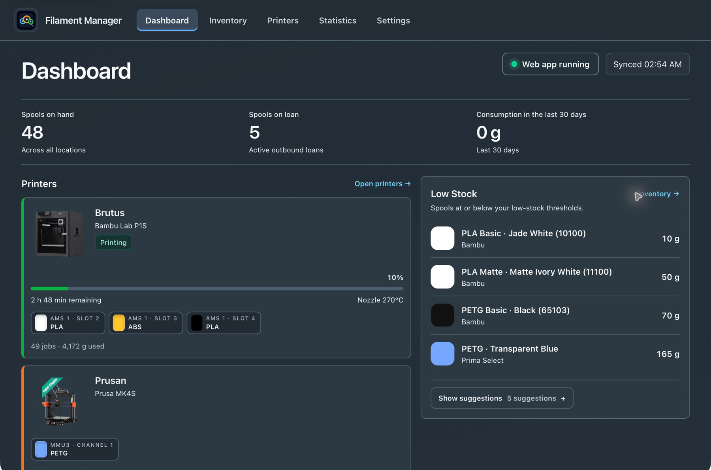
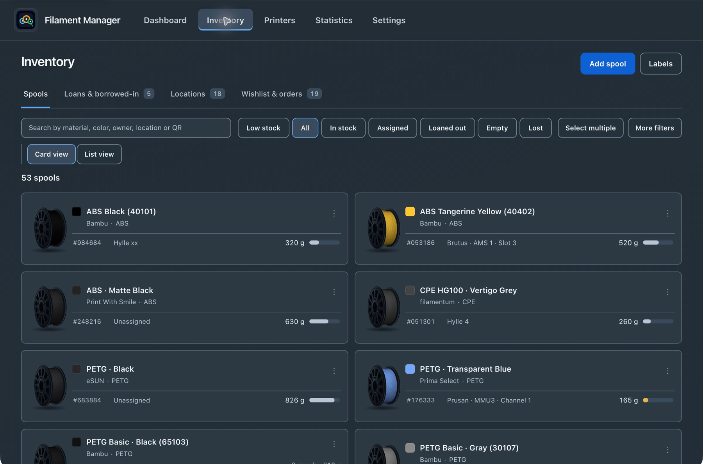
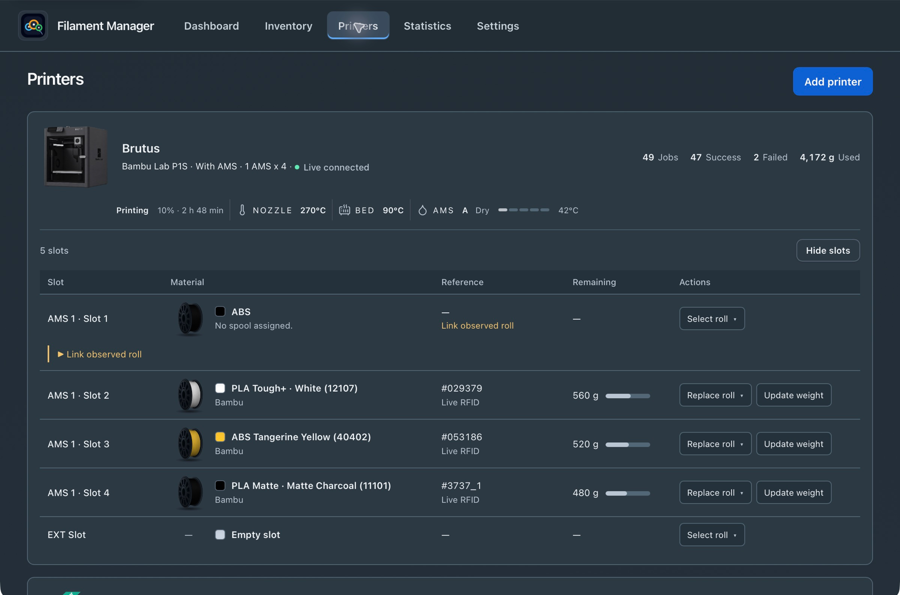
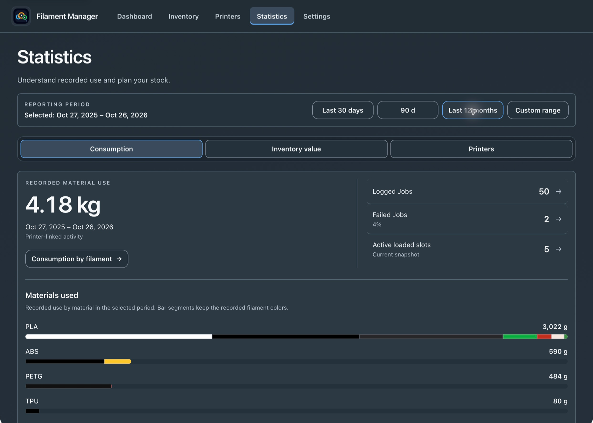
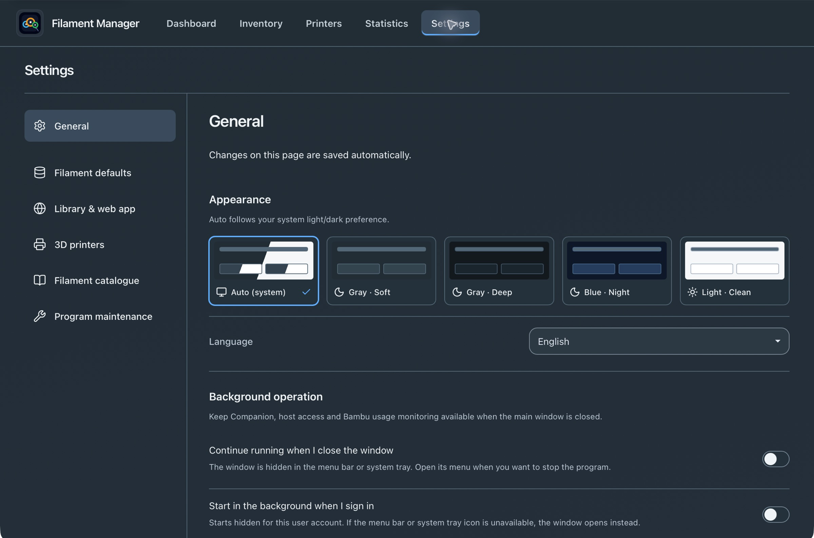
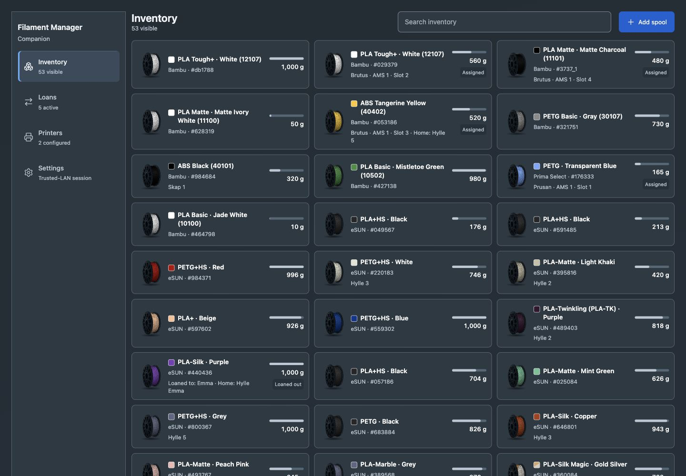
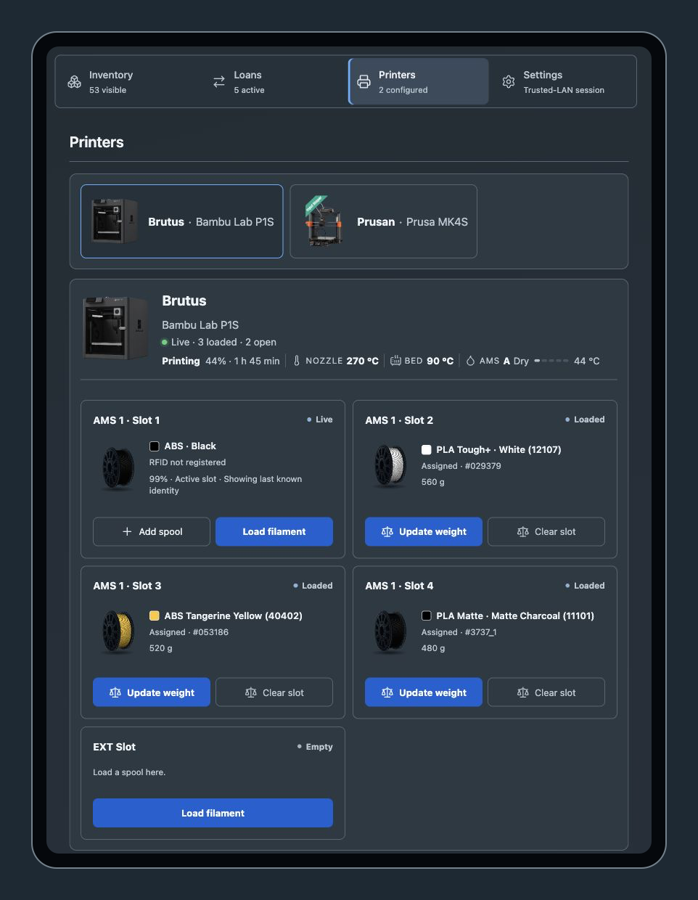
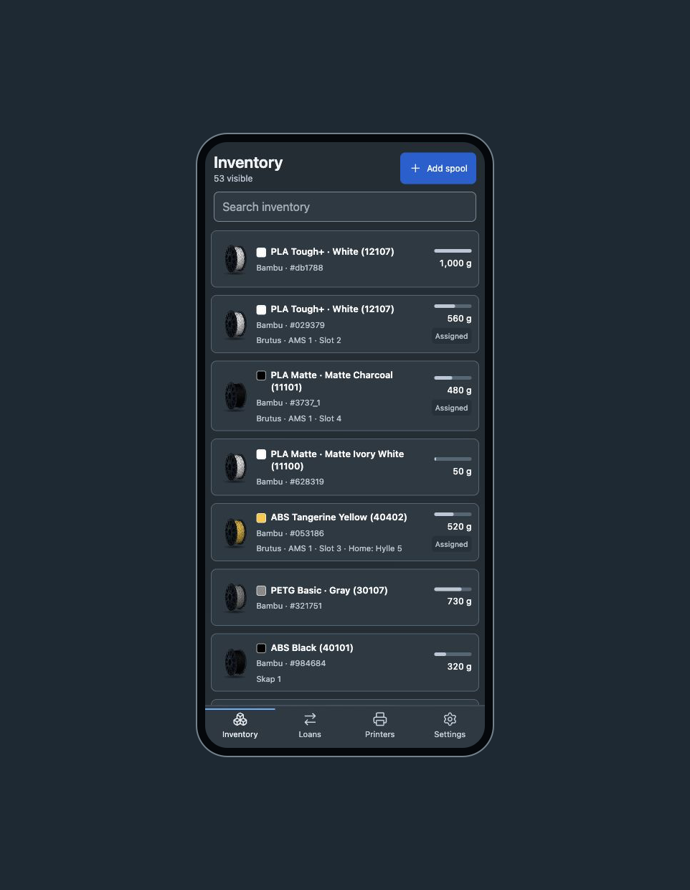

# Filament Manager

[**Download latest release · v0.35.1**](https://github.com/bliatun-code/Filament-Manager/releases/latest) · [English guide](docs/USER_GUIDE.md) · [Norsk veiledning](docs/BRUKERVEILEDNING.md)

Know what filament you have, where it is and what is loaded in your printers.
Keep track of remaining weight, usage and loans, and find the right spool for
your next print.

Use Filament Manager on one computer, share a library from a Host, or connect
another desktop as a Client. Companion brings that library to phones, tablets
and browsers on your local network. Available for macOS and Windows.

<table>
<tr>
<td width="50%" valign="top"><strong>Overview</strong> 
 
See your stock, loaded printers and low-filament reminders at a glance.</td>
<td width="50%" valign="top"><strong>Inventory</strong> 
 
Choose filament by colour, find each spool and track remaining weight and loans.</td>
</tr>
<tr>
<td width="50%" valign="top"><strong>Printers</strong> 
 
See what is loaded and keep spool changes and outgoing weights in sync.</td>
<td width="50%" valign="top"><strong>Statistics</strong> 
 
Follow filament consumption, printer activity and the value of your stock.</td>
</tr>
<tr>
<td width="50%" valign="top"><strong>Settings</strong> 
 
Choose your theme, filament defaults and how your library is shared.</td>
<td width="50%" valign="top"><strong>Companion in the browser</strong> 
 
Use the same library from another computer on your local network.</td>
</tr>
<tr>
<td width="50%" valign="top"><strong>Companion on a tablet</strong> 
 
Keep printer slots and filament choices close at hand in the workshop.</td>
<td width="50%" valign="top"><strong>Companion on a phone</strong> 
 
Find a spool, update its weight or manage a loan from your phone.</td>
</tr>
</table>

Click an image to open the full-size version.

[AGPL-3.0-or-later](LICENSE)
