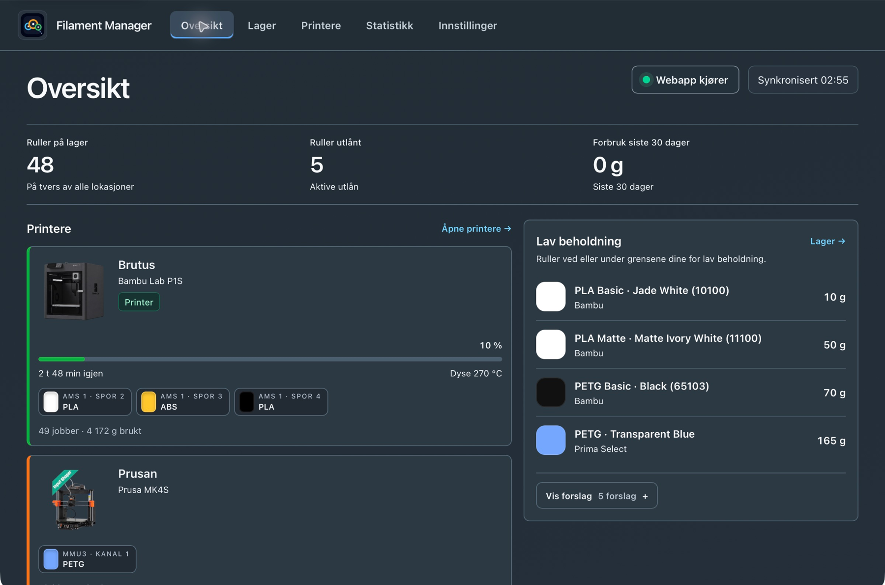
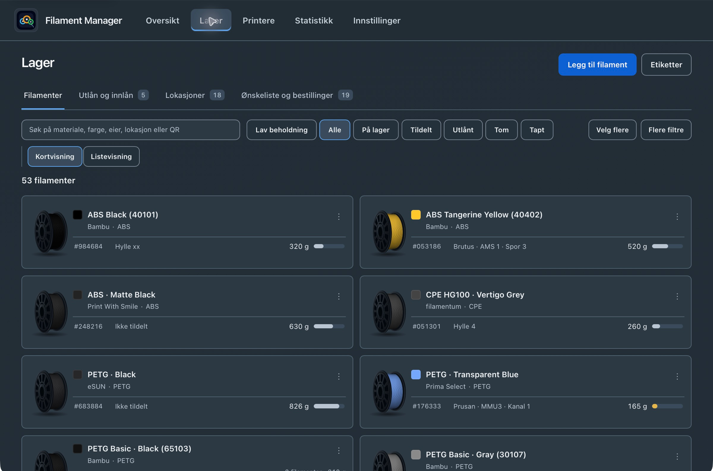
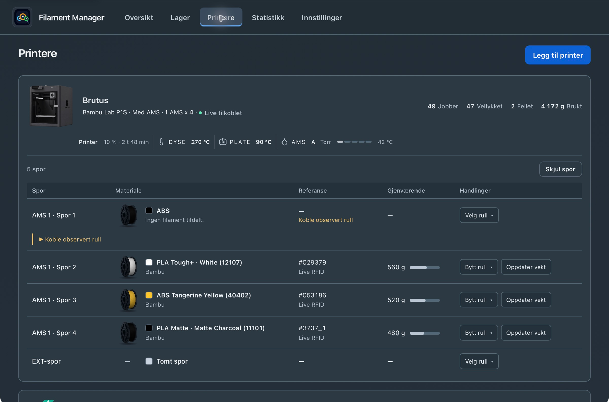
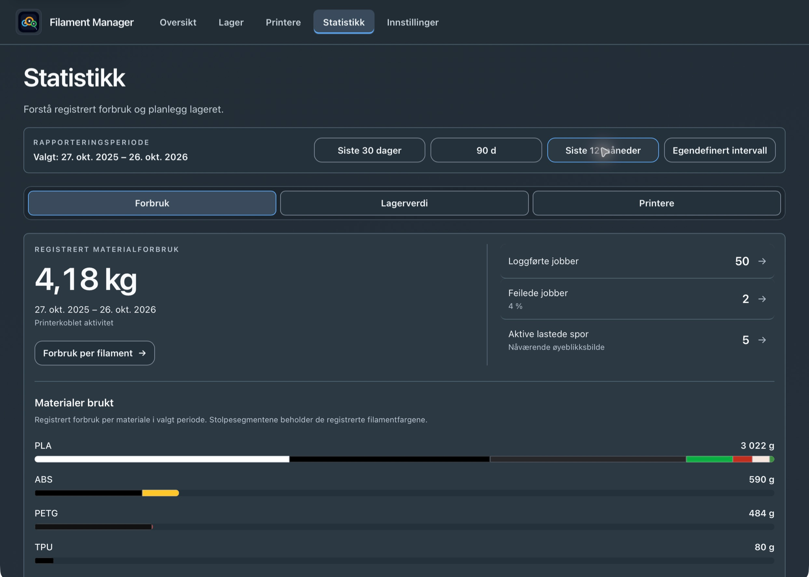
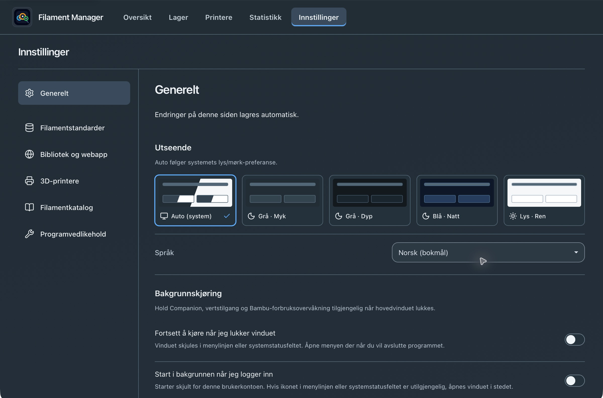
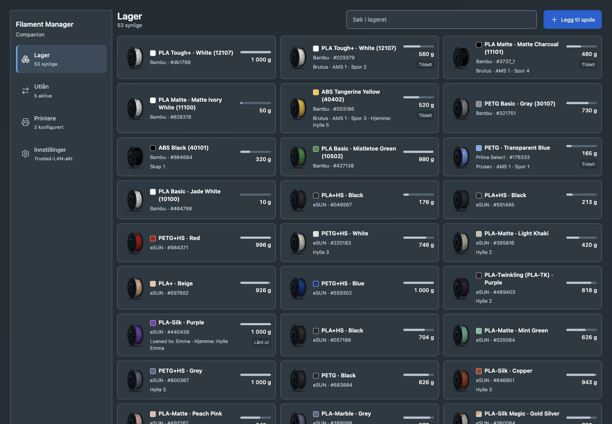
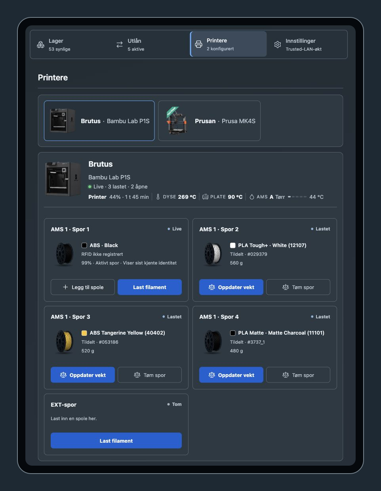
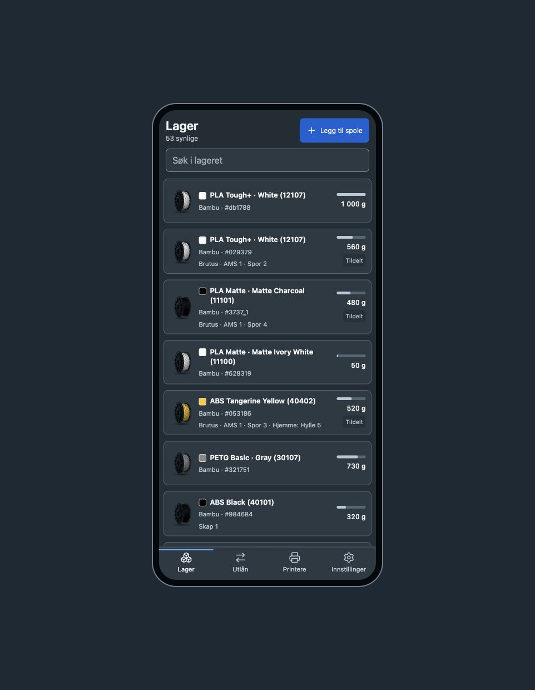

# Filament Manager — brukerveiledning

[Last ned siste versjon](https://github.com/bliatun-code/Filament-Manager/releases/latest) · [English guide](USER_GUIDE.md)

Hold oversikt over filament, gjenværende vekt, utlån og lastede printerspor.

## Kom i gang

1. Installer DMG for macOS eller MSI for Windows fra siste release.
2. Legg inn filamentet ditt under **Lager → Legg til filament**.
3. Legg til printerne og plasser rullene i riktige spor.
4. Velg språk og tema under **Innstillinger → Generelt**.

## Ett bibliotek, flere måter å bruke det på

**Enkeltstående** lagrer biblioteket på denne maskinen. **Vert** deler biblioteket
med andre enheter. **Klient** kobler en annen datamaskin til verten.
Velg rollen under **Innstillinger → Bibliotek og webapp**, og la verten være på
mens andre enheter bruker biblioteket.

## Oversikt

Se tilgjengelige ruller, lastede printere og lav beholdning samlet. Kjøpsforslagene er kollapset til du trenger dem.

## Lager

Søk eller filtrer etter materiale og farge, og åpne en rull for å se plassering og gjenværende vekt. Utlån, lokasjoner og bestillinger har egne faner i Lager.

## Printere

Plasser, bytt eller fjern ruller i printersporene. Koble en observert rull via kandidatlisten, eller legg den til fra katalogen. Vei utgående ruller uten registrert Bambu-RFID.

## Statistikk

Følg forbruk, lagerverdi og printerbruk. Velg en periode for å se tallene bak aktiviteten i verkstedet.

## Innstillinger

Velg språk, tema, grenser for lav beholdning og filamentstandarder. Aktiver Bambu Live og deling av biblioteket når du trenger det.

## Companion i nettleseren

Aktiver Companion under Bibliotek og webapp, og åpne en parringslenke eller skann QR-koden. Godkjente nettlesere bruker samme bibliotek og kan sperres fra verten.

## Companion på nettbrett

Bruk nettbrettvisningen til å sjekke printerspor og velge filament ved printeren. Verten må være på og tilgjengelig i lokalnettet.

## Companion på mobil

Finn en rull, oppdater vekt eller håndter et utlån fra mobilen. Mister du tilgang, ber du om den på nytt og skriver inn den sekssifrede koden etter godkjenning på verten.

## Hold vektene og dataene nyttige

Oppgi **total målt rullvekt** når veieskjemaet ber om det. Programmet trekker fra
valgt tomspolevekt, så sjekk denne før du lagrer. Innkommende umerkede ruller kan
bruke registrert vekt; veiing ved uttak holder lager og printerforbruk oppdatert.

## Forny tilgang eller ta sikkerhetskopi

Godkjente nettlesere fornyes automatisk med en løpende gyldighet på ett år.
En reaktiveringskode gjelder i fem minutter og gir maksimalt tre forsøk.
Godta bare enheter du kjenner. Parringslenke og QR-kode kan fortsatt brukes.

Eksporter full sikkerhetskopi under **Innstillinger → Programvedlikehold** før du
flytter eller gjenoppretter et bibliotek. Oppdater vert og klienter sammen.
